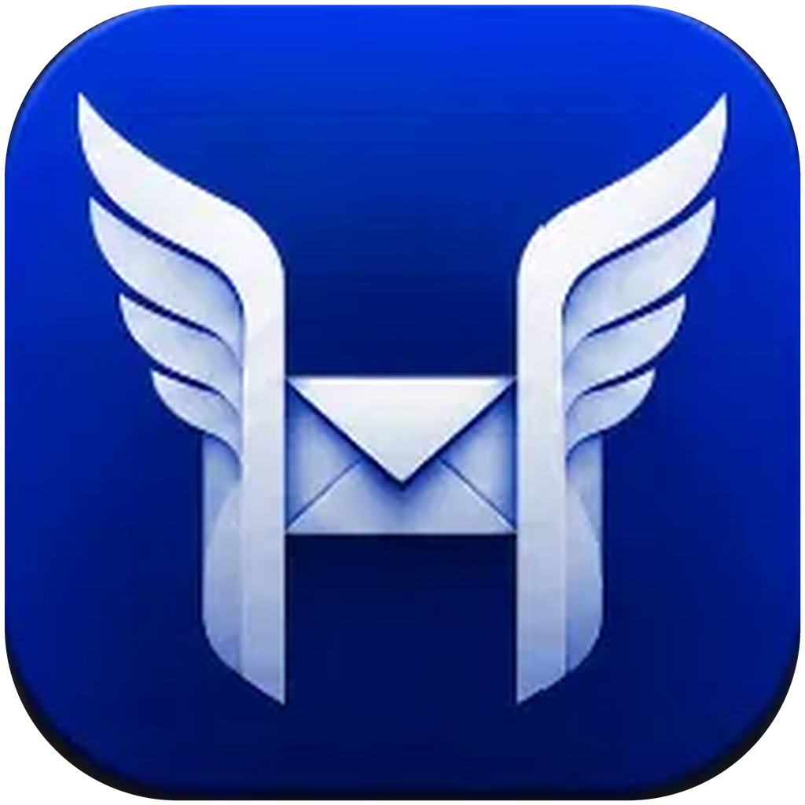

<p align="center">
  
</p>

<h1 align="center">Hermio</h1>
<p align="center"><b>Automate your inbox flow.</b></p>

<p align="center">
  A fast email client for Windows 11 with an AI assistant that can run on your own NPU.<br/>
  Built with Tauri 2 (Rust) and Svelte 5.
</p>

<p align="center">
  <a href="https://github.com/nev-minhnh/Hermio/actions/workflows/build.yml"></a>
  
  
</p>

> Hermio was called **Nelo** before 0.5.0. See [Upgrading from Nelo](#upgrading-from-nelo).

## Features

**Mail**
- IMAP with two-way sync (read, flags, moves, deletes, folders) and POP3 (mail kept as `.eml`
  files, with a separate folder per account).
- Gmail and Google Workspace sign-in with OAuth 2.0 (PKCE) or an App Password.
- Unified inbox, Unread and Flagged views. A sync log shows what every mailbox is doing.
- Rich-text composer with recipient suggestions, attachments, per-account signatures, drafts,
  a forgotten-attachment reminder, scheduled send and undo send.
- In-app preview of attachments (images, PDF, video, text, Office documents).
- Remote images are blocked by default, with a list of trusted senders.
- Passwords and tokens are stored in Windows Credential Manager.

**Search**
- Full-text search (SQLite FTS5) that ignores accents. Modes: Subject, Content, People.
- `from:`, `to:`, `cc:` and `"exact phrase"` operators.
- Matches are highlighted in the list, the snippet and the message.

**Organise**
- Groups at two levels: shared across all mailboxes, or per mailbox. Mail in a group is kept
  out of the inbox.
- Rules apply to new mail and, if you choose, to existing mail.
- **AI clustering by content.** The AI labels each email with a topic (Marketing, Promotions,
  Newsletters, Security, Receipts & finance, Thesis & research, Jobs, Travel, Spam…). A group
  can span many senders. Hermio then builds a rule for each group and checks it against your
  mail, showing how many emails it catches inside and outside the group.

**AI assistant**
- Providers: ChatGPT, Gemini, Claude API, Claude Code CLI, Grok, local OpenAI-compatible
  servers (llama.cpp and similar).
- **On-device AI on the NPU:** AMD Ryzen AI through
  [FastFlowLM](https://github.com/FastFlowLM/FastFlowLM) and Intel Core Ultra through
  [OpenVINO Model Server](https://github.com/openvinotoolkit/model_server). Hermio installs the
  driver and runtime and downloads models. The NPU options are hidden on PCs without one.
- Streaming answers, a live "Thinking…" block and a Stop button that works at once.
- Summaries and reports read every email in the selected scope (time range and mailboxes).
- Citations `[E1]`, `[E2]`… with a list of the cited emails. Open them with Alt+1…9 or by
  typing `#n`.
- Also reads attachments, searches the web, runs OCR on scanned PDFs, installs skills, rewrites
  replies and writes signatures.
- Background group suggestions for new mail. They give way to you whenever you use the AI.

**Calendar**
- Google Calendar day, week and month views: create, edit and delete events.
- Meeting invitations from email can be added to the calendar.
- A local calendar for other accounts.

**Look and feel**
- Light, dark or system theme in Hermio blue, or any accent colour you like.
- Comfortable or compact density and adjustable text size.
- Reading pane on the right, at the bottom or hidden.
- English and Vietnamese.
- Smooth transitions throughout. They respect "reduce motion".

**Your data**
- Export and import the configuration. Secrets are encrypted with Windows DPAPI.
- Full backup to a `.zip` and restore. A restore is swapped in when Hermio restarts.
- Copy all data from another copy (portable ↔ installed, Nelo → Hermio).

## Download

Windows builds are produced by [GitHub Actions](https://github.com/nev-minhnh/Hermio/actions)
on every push. Tagged versions are attached to
[Releases](https://github.com/nev-minhnh/Hermio/releases):

- `Hermio-<version>-installer.zip` contains a per-user NSIS installer.
- `Hermio-<version>-portable.zip`: unzip and run `Hermio.exe`. Data stays in the `data`
  folder next to it.

Requires Windows 10/11 with the WebView2 Runtime (built into Windows 11).

## Upgrading from Nelo

- **Installed app:** on its first start Hermio moves Nelo's data folder
  (`%APPDATA%\app.nelo.mail`) to its own (`%APPDATA%\app.hermio.mail`) and updates the stored
  paths. Saved passwords and tokens are moved from "Nelo Mail" to "Hermio Mail" in Windows
  Credential Manager the first time they are used. You can uninstall Nelo afterwards.
- **Portable copy:** go to *Settings → Backup & transfer → Copy data from an older copy* and
  choose the old Nelo folder (the one with `Nelo.exe`).
- Configuration and backup files exported by Nelo can be imported into Hermio.
- If your Google sign-in used your own OAuth client, consider renaming its consent screen to
  Hermio in Google Cloud Console.

## Building

Requirements: Node 20+, Rust stable (1.88+), and on Windows the WebView2 Runtime and the MSVC
build tools.

```powershell
npm ci
npm run tauri build -- --bundles nsis   # Windows
python scripts/package.py               # zips into dist-zips/
```

To cross-build from Linux (mingw-w64 + NSIS), run `./build-windows.sh`.

### Built-in Google sign-in and Gemini key (optional)

Hermio can embed a Google OAuth client (Desktop app) and a Gemini API key at build time, so
users can sign in with one click:

| Variable | Purpose |
| --- | --- |
| `HERMIO_GOOGLE_CLIENT_ID` | Google OAuth client ID (Desktop app) |
| `HERMIO_GOOGLE_CLIENT_SECRET` | Its client secret |
| `HERMIO_GEMINI_KEY` | Default Gemini API key (optional) |

- **Local builds:** copy `secrets.example.env` to `secrets.local.env` (git-ignored) and fill it in.
- **GitHub Actions:** add the variables as repository secrets (*Settings → Secrets and
  variables → Actions*).

Anything embedded in an `.exe` can be extracted from it. Google treats installed-app client
secrets as non-confidential, but **do not embed a Gemini key in builds you publish**, or limit
it strictly (quota, Generative Language API only).

Without these variables, users enter their own client under *Settings → Google sign-in*:

1. In Google Cloud Console, create a project.
2. Enable the **Gmail API** and the **Google Calendar API**.
3. Under Google Auth Platform → Audience, choose *External* and add yourself as a test user.
4. Under Clients, create a client of type **Desktop app**, then paste its ID and secret into
   Hermio.

Google Workspace accounts (school or company) may need an administrator to allow third-party
apps.

## Project layout

```
src/                Svelte 5 front end (components, stores, i18n)
src-tauri/src/      Rust back end: IMAP/POP3/SMTP, SQLite + FTS5, OAuth, rules, AI, NPU runtimes, backup
scripts/            packaging and cross-build helpers
.github/workflows/  Windows build on GitHub Actions
```

Data lives in `%APPDATA%\app.hermio.mail`, or in `data\` next to `Hermio.exe` in portable mode.

## Contributing

Issues and pull requests are welcome. See [CONTRIBUTING.md](CONTRIBUTING.md). Report security
problems as described in [SECURITY.md](SECURITY.md).

## License

Hermio is dual-licensed under either of

- [MIT License](LICENSE-MIT)
- [Apache License, Version 2.0](LICENSE-APACHE)

at your option. Unless you explicitly state otherwise, any contribution you submit for
inclusion in Hermio, as defined in the Apache-2.0 license, is dual-licensed as above, without
any additional terms or conditions. Third-party components are listed in [NOTICE](NOTICE).
